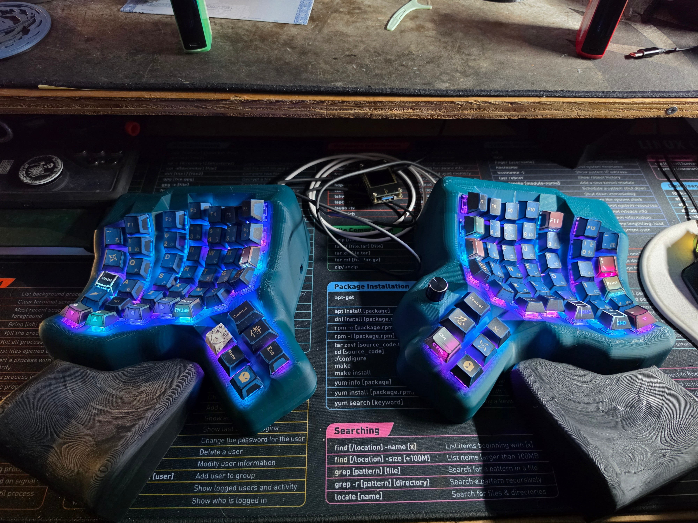
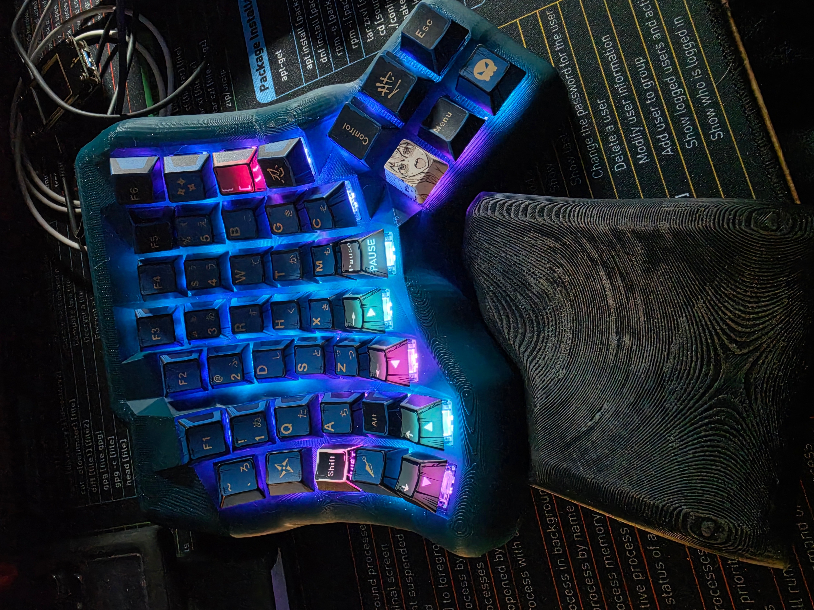
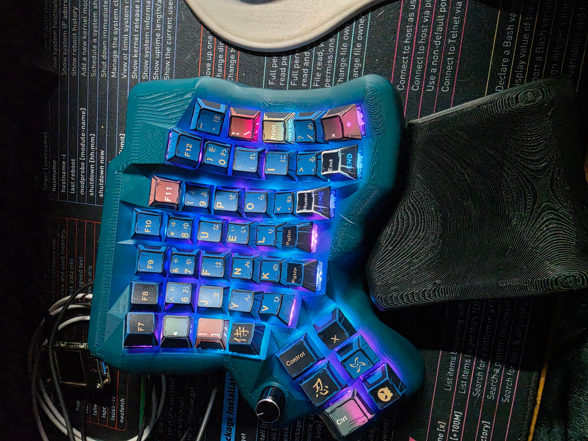
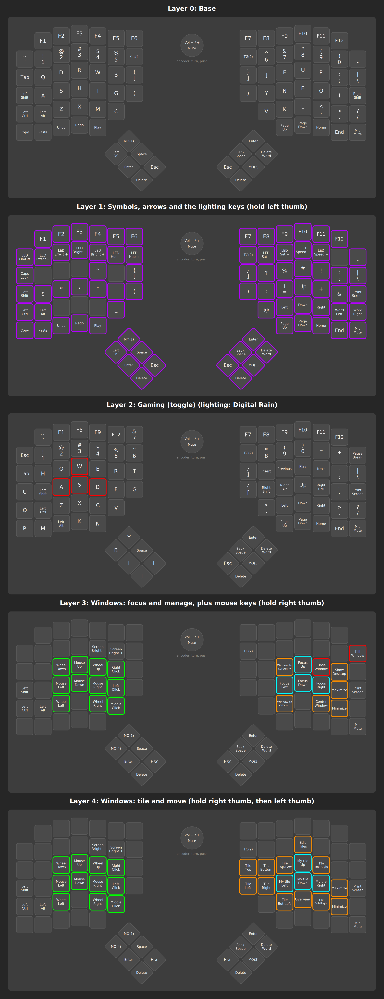

# Astvaldr

Astvaldr is a split ergonomic keyboard with 88 keys. Each half runs on an RP2040
microcontroller with QMK firmware. It supports live remapping in VIA, has per-key
RGB matrix lighting, and the right half carries an EC11 rotary encoder (volume on
turn, mute on push).



| Left half | Right half |
| :---: | :---: |
|  |  |

## Repository layout

| Path | Contents |
| :--- | :--- |
| `hardware/stl/` | Printable case, bottom plate and wrist rest, left and right |
| `hardware/lykill_astvaldr.lykill.json` | The Lykill design file the STLs were generated from |
| `hardware/lykill_astvaldr_stl_manifest.json` | List of the exported STL components |
| `hardware/photos/` | Photos of the finished board |
| `firmware/` | QMK keyboard definition, keymap source, generator, flashing tools, layer pictures |

## Credits

- Case designed and generated with [Lykill](https://thefactionllc.com).
- PCBs and microcontrollers are [Cosmos Keyboards](https://ryanis.cool/cosmos/) parts
  by rianadon ([generator source on GitHub](https://github.com/rianadon/Cosmos-Keyboards)).
- Firmware built on [QMK](https://qmk.fm).

## Parts

The electronics come from the [Cosmos store](https://cosmos-store.ryanis.cool/):

| Part | Notes |
| :--- | :--- |
| Lemon Wired microcontroller | 2, one per half |
| Pumpkin Patch PCB (MX) | one per half |
| Pumpkin Vine PCB (MX, six-key version) | one per half |
| VIK Breakout | carries the rotary encoder on the right half |
| FPC Connector for VIK | connects the VIK Breakout |

Builders source the rest themselves: MX-style switches, keycaps, the EC11 rotary
encoder and its knob, the fasteners and the USB cables.

## Printing the case

These are the settings the original board was printed with:

- **Printer:** Elegoo Centauri Carbon 2, 0.4 mm nozzle, smooth bed plate.
- **Filament:** PLA Pro.
- **Supports:** standard supports. Remove (block) supports from the heat-set insert
  bosses. Support base gap 5 mm.
- **Post-processing:** remove the supports carefully, then pass a torch quickly over
  the print to clear stringing.

### Fasteners

The Lykill design file sets the fasteners to screws, size M2, with counterbored
screw heads for both the faceplate and the bottom plate. The screw bosses are 6.4 mm
in diameter (3.2 mm radius) and 10 mm tall, five on the left half and six on the right.
The case takes heat-set inserts in those bosses. The original build used 3 mm
heat-set inserts.

## Firmware

Everything here lives in `firmware/`. Run the Python tools with the virtual
environment described below.

### Layers

Five layers. Every key on every layer is set, so no key falls through to a lower
layer; keys a layer does not use do nothing and stay dark.

| Layer | Name | How to reach it |
| :--- | :--- | :--- |
| 0 | Base | Default |
| 1 | Symbols and arrows | Hold the left thumb key |
| 2 | Gaming | Toggle (TG) key; switches the lighting to Digital Rain with WASD in red |
| 3 | Windows: focus | Hold the right thumb key |
| 4 | Windows: tile and move | Hold both thumb keys |

Layers 3 and 4 send KDE Plasma window shortcuts (focus, move to screen, quick tile,
custom tiles, maximize, minimize, close). After a focus or screen move the board also
sends `Meta+F5` (Move Mouse to Focus), so the pointer follows the window. Other desktops
need the same shortcuts bound, or the keys changed in `layers.json`.



Single layers: [layer 0](firmware/pictures/astvaldr-layer-0.png),
[layer 1](firmware/pictures/astvaldr-layer-1.png),
[layer 2 (gaming)](firmware/pictures/astvaldr-gaming-layer.png),
[layer 3](firmware/pictures/astvaldr-layer-3.png),
[layer 4](firmware/pictures/astvaldr-layer-4.png).

### Lighting

[`firmware/led-effects.md`](firmware/led-effects.md) lists every RGB matrix effect,
what it looks like, whether the hue and saturation keys change it, and whether it
reacts to typing.

Brightness is capped at 96 of 255. Solid white at the cap draws about 0.43 A,
measured with a USB meter, under the 500 mA the board asks the host for.

### Firmware variants

There are two ready builds. Pick one and flash its left and right files:

| Files | Effects | Notes |
| :--- | :--- | :--- |
| `astvaldr-left.uf2`, `astvaldr-right.uf2` | 30 | Default. The effects kept after a tour of all of them |
| `astvaldr-full-left.uf2`, `astvaldr-full-right.uf2` | 50 | Every RGB matrix effect QMK has |

The Effect +/- keys step through a build's effects in order, so an effect's number is
different in the two builds. `led-effects.md` lists both numberings and which effects the
default build keeps. To build the full variant yourself, run
`gen_astvaldr.py --all-effects` before compiling.

### Source files

- `layers.json`: the keymap, every layer, keyed by switch name. This is the file to edit.
- `switches.json`: where each switch sits.
- `left-matrix.json`, `right-matrix.json`: the matrix row and column each switch is wired to.
- `left-leds.json`, `right-leds.json`: each half's LED chain order.
- `gen_astvaldr.py`: writes `keyboards/astvaldr/keyboard.json`,
  `keyboards/astvaldr/keymaps/default/keymap.c` and `astvaldr-via.json` from the files
  above. Do not edit the generated files by hand.
- `render_layers.py`: draws the layer pictures in `pictures/`.
- `via_import.py`: copies a keymap saved from the VIA app back into `layers.json`.
- `keyboards/astvaldr_tester/`: a matrix tester firmware for checking the wiring of
  one half; `astvaldr_tester_default.uf2` is a ready build of it.
- `keyboards/astvaldr_tester/keymaps/ledmap/`: an LED mapper for checking a half's LED
  chain against `*-leds.json`. It lights one LED at a time; tap the key on the lit LED
  and the console prints `LED n R<row> C<col>`, or wait 3 s if no key sits on it.
  `astvaldr-ledmap.uf2` is a ready build that works on either half. Read the console
  with `console_listen.py`. Flash the normal firmware back afterwards.
- `astvaldr-*.uf2`: ready builds (see Firmware variants).

### Setup

```sh
cd firmware
python3 -m venv .venv
.venv/bin/pip install qmk cairosvg pillow
.venv/bin/qmk setup        # once, if you do not have a QMK tree yet
```

Link (or copy) `firmware/keyboards/astvaldr` into the QMK tree as
`qmk_firmware/keyboards/astvaldr`.

### Generate, build and flash

1. After changing `layers.json`, regenerate:

   ```sh
   .venv/bin/python gen_astvaldr.py
   .venv/bin/python render_layers.py   # optional: redraw the pictures
   ```

2. Build each half from inside the QMK tree, with `.venv/bin` first on `PATH`. The
   flag sets which half the firmware is for:

   ```sh
   qmk compile -c -kb astvaldr -km default -e EXTRAFLAGS=-DINIT_EE_HANDS_LEFT
   qmk compile -c -kb astvaldr -km default -e EXTRAFLAGS=-DINIT_EE_HANDS_RIGHT
   ```

   Each build writes `astvaldr_default.uf2` to the QMK tree. Rename them to
   `astvaldr-left.uf2` and `astvaldr-right.uf2`.

3. Flash with one half plugged in at a time:

   ```sh
   .venv/bin/python flash.py astvaldr-left.uf2
   ```

   `flash.py` sends the running half to its bootloader over USB (no button needed),
   copies the file onto the RPI-RP2 drive, then resets the keymap stored by VIA to the
   one in the firmware. A file named `*-left.uf2` or `*-right.uf2` is only flashed onto
   the matching half, identified by its USB serial number.

### Your board serials

The serials in the "EDIT ME" block at the top of `flash.py` belong to the original
board. Replace them with your own: plug in one half (running its firmware, not in
flash mode) and run

```sh
.venv/bin/python flash.py --serial
```

It prints that half's serial and exits without flashing or sending anything to the
board. Put it in the line for that half, then repeat with the other half. A board
already in flash mode cannot show its serial; `flash.py <file> --unchecked` skips the
check.

### udev rule

On Linux, the VIA app, `flash.py` and the tester console need access to the board's
raw HID interface. Install the rule once:

```sh
sudo cp firmware/50-astvaldr.rules /etc/udev/rules.d/
sudo udevadm control --reload-rules && sudo udevadm trigger
```

### VIA

Load `firmware/astvaldr-via.json` into the VIA app as the keyboard's definition
(Design tab) to remap keys live.

## Licenses

- `firmware/`: GNU General Public License v2.0 or later (GPL-2.0-or-later).
  See [`firmware/LICENSE`](firmware/LICENSE).
- `hardware/`: Creative Commons Attribution-ShareAlike 4.0 International (CC BY-SA 4.0).
  See [`hardware/LICENSE`](hardware/LICENSE).

Copyright (C) 2026 magealexstra.
